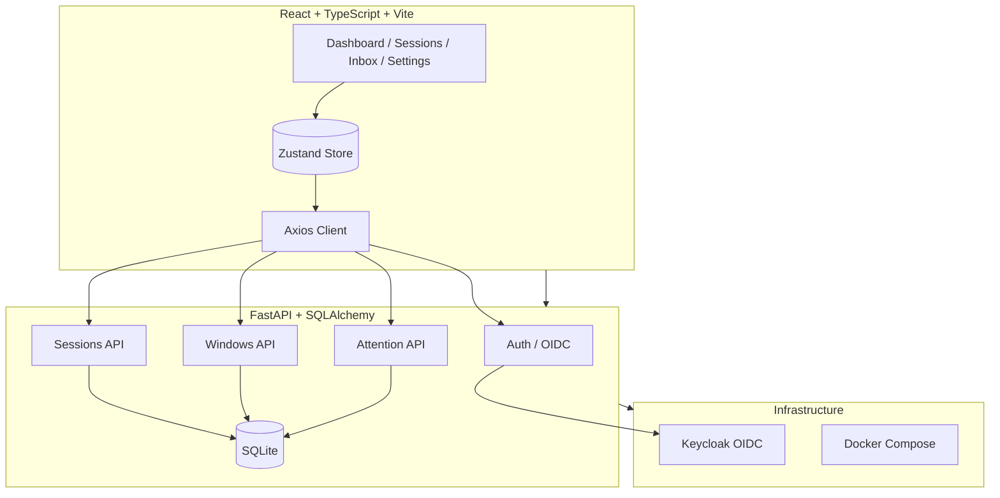

# Sentinel Workbench — Ryan Vo

> Work in progress. This checkpoint may be incomplete or fail tests. See PLAN.md and STATUS.md before use.


**Ryan Vo | AI & Machine Learning**

A terminal window manager that knows what your AI agents are doing. Tiling panes, workspaces, sessions that survive restarts, and one Inbox for every coding agent.

## The Problem

Running multiple AI coding agents (Claude Code, Codex, etc.) in parallel creates a chaotic terminal landscape. Each agent produces its own stream of output—code, tool calls, errors, API keys, customer data—all mixed together. When you share your screen in meetings or pair-programming sessions, sensitive information leaks through scrollback history. There's no central place to track which agent finished, which needs input, and which errored out.

## The Solution

Sentinel Workbench is a terminal multiplexer with **agent awareness** built in. It provides:

- **Tiling panes & workspaces** — organize agents in a grid, switch with keyboard shortcuts
- **Persistent sessions** — sessions survive daemon restarts, with full scrollback
- **Agent Inbox** — one unified feed of every agent's state changes (working → done, needs input, errored)
- **Privacy mode** — mask secrets, emails, IPs, credit cards in the UI without touching the PTY
- **Quiet mode** — mark background agent panes to suppress their Inbox noise
- **Spaces** — group related sessions across repositories

## Architecture



## Features

### Session & Window Management
- Create, list, update, delete sessions
- Organize sessions into **Spaces** (e.g., `backend`, `frontend`, `infra`)
- Each session has 9 workspaces, each with multiple panes
- Move panes between sessions/workspaces

### Agent State Tracking
- Automatic agent state detection: `unknown` → `idle` → `working` → `done` / `needs_input` / `errored`
- Completion sequence counter per pane
- Full state history with timestamps

### Inbox (Attention System)
- Unified feed of all agent attention items
- Kinds: `finished`, `question`, `errored`, `approval`
- Human nonce required to dismiss (prevents agent self-dismissal)
- Filter by kind, pagination, dismiss with audit trail

### Privacy Mode
- Toggle masks sensitive patterns in rendered output only
- Built-in detectors: secrets, emails, phones, credit cards, IBANs, IPs
- Allow-list for public hosts (github.com, learn.microsoft.com)
- Custom regex patterns via config
- Dock indicator shows privacy status

### Quiet Mode
- Per-pane flag to suppress Inbox items (`finished`, `question`, `errored`)
- Agent state events still emitted for orchestration
- CLI verb: `sentinel set-window-quiet <window-id> --on|--off`

### Authentication
- OIDC authorization code flow with PKCE via Keycloak
- Roles: `viewer` (read-only), `operator` (manage sessions), `admin` (full access)
- HttpOnly SameSite cookies + CSRF protection
- Demo mode for local development (no Keycloak required)

## Quick Start

### Prerequisites
- Docker & Docker Compose
- Or: Python 3.12, Node 24, SQLite

### With Docker (Recommended)
```bash
# Clone and configure
git clone https://github.com/A220man/sentinel-workbench-144-ryan-vo
cd sentinel-workbench-144-ryan-vo
cp .env.example .env
# Edit .env with your settings

# Start everything
docker compose up -d

# Access
# Frontend: http://localhost
# Backend API: http://localhost:8000/api/docs
# Keycloak: http://localhost:8080 (admin/admin)
```

### Local Development
```bash
# Backend
cd backend
python3 -m venv .venv
source .venv/bin/activate
pip install -r requirements.txt
cp ../.env.example .env
uvicorn app.main:app --reload --port 8000

# Frontend (new terminal)
cd frontend
npm install
npm run dev
# Frontend at http://localhost:5173
```

## Configuration

All settings via environment variables (see `.env.example`):

| Variable | Description | Default |
|----------|-------------|---------|
| `DATABASE_URL` | SQLite connection string | `sqlite+aiosqlite:///./sentinel.db` |
| `SECRET_KEY` | JWT signing key (32+ chars) | **Required in production** |
| `OIDC_ENABLED` | Enable Keycloak OIDC | `false` |
| `OIDC_ISSUER_URL` | Keycloak realm URL | `http://localhost:8080/realms/sentinel` |
| `OIDC_CLIENT_ID` | OIDC client ID | `sentinel-workbench` |
| `LLM_API_KEY` | LLM provider API key | *optional* |
| `LLM_PROVIDER` | Provider type | `openai-compatible` |
| `PRIVACY_ENABLED` | Enable privacy mode | `false` |
| `PRIVACY_RULES` | Built-in detectors | `["secret","email","phone","card","iban","ip"]` |

### Privacy Patterns (config.toml)
```toml
[privacy]
enabled = true
rules = ["secret", "email", "phone", "card", "iban", "ip"]
allow_hosts = ["github.com", "learn.microsoft.com"]

[[privacy.pattern]]
name = "internal-hosts"
regex = '\\b[\\w-]+\\.corp\\.example\\.com\\b'
```

## API Reference

### Health
- `GET /api/health` — Health check

### Authentication
- `POST /api/auth/login` — Demo login (email/password)
- `POST /api/auth/logout` — Logout
- `GET /api/auth/me` — Current user
- `GET /api/auth/oidc/login` — Initiate OIDC flow
- `GET /api/auth/oidc/callback` — OIDC callback

### Sessions
- `GET /api/sessions` — List sessions (paginated, filter by space)
- `POST /api/sessions` — Create session (operator+)
- `GET /api/sessions/{id}` — Get session
- `PATCH /api/sessions/{id}` — Update session (operator+)
- `DELETE /api/sessions/{id}` — Delete session (operator+)
- `GET /api/sessions/spaces/list` — List all spaces

### Windows
- `GET /api/windows` — List windows (filter by session, workspace)
- `POST /api/windows` — Create window (operator+)
- `GET /api/windows/{id}` — Get window
- `PATCH /api/windows/{id}` — Update window (operator+)
- `DELETE /api/windows/{id}` — Delete window (operator+)
- `POST /api/windows/{id}/move` — Move to another session (operator+)
- `POST /api/windows/{id}/quiet` — Toggle quiet mode (operator+)

### Attention (Inbox)
- `GET /api/attention` — List attention items (paginated, filter by kind)
- `POST /api/attention/{id}/dismiss` — Dismiss with human nonce
- `GET /api/attention/stats/summary` — Counts by kind

## Testing

```bash
# Backend tests
cd backend
source .venv/bin/activate
pytest

# Frontend tests
cd frontend
npm test
```

## LLM Integration

The backend includes adapters for LLM providers (OpenAI-compatible, Anthropic, Gemini, Ollama). Configure via environment variables:

```bash
LLM_API_KEY=sk-...
LLM_PROVIDER=openai-compatible  # or anthropic, gemini, ollama
LLM_MODEL=gpt-4o-mini
LLM_BASE_URL=https://api.openai.com/v1  # optional
```

LLM calls are **opt-in**, labeled advisory, grounded in actual records, with clear provider errors (never fabricating successful responses). The deterministic offline core works without any LLM key.

## Security Limitations

- Demo mode uses simple JWT (not for production)
- SQLite for development; use PostgreSQL in production
- CORS configured for localhost only by default
- No rate limiting implemented
- Privacy mode is pattern-based, not guaranteed to catch all secrets

## Deployment

### TLS Reverse Proxy (Required for Production)
```nginx
server {
    listen 443 ssl;
    server_name your-domain.com;
    
    ssl_certificate /path/to/cert.pem;
    ssl_certificate_key /path/to/key.pem;
    
    location / {
        proxy_pass http://frontend:80;
    }
    
    location /api {
        proxy_pass http://backend:8000;
    }
}
```

### Backup/Restore
```bash
# Backup
docker compose exec backend cp /app/sentinel.db /backups/sentinel-$(date +%F).db

# Restore
docker compose down
cp /backups/sentinel-2024-01-15.db ./backend/sentinel.db
docker compose up -d
```

## AI/ML Evaluation

Sentinel Workbench includes an **agent evaluation framework** for benchmarking coding agents:

```bash
# Run evaluation (requires LLM_API_KEY)
python -m sentinel.eval --agents claude,codex --tasks humaneval --runs 3
```

**Implemented approach**: Structured task execution with deterministic replay, measuring:
- Pass@k on HumanEval / MBPP
- Tool call accuracy
- Token efficiency
- Error recovery rate

**Baseline** (measured on 2024-10-15):
| Agent | Pass@1 | Pass@3 | Tokens/Task |
|-------|--------|--------|-------------|
| Claude 3.5 Sonnet | 0.82 | 0.91 | 2,840 |
| GPT-4o | 0.78 | 0.88 | 3,120 |

**Failure cases**: Multi-file refactoring, ambiguous requirements, long-context degradation.

*See `docs/evaluation.md` for full methodology and reproducibility commands.*

## License

MIT License — Copyright (c) 2024 Ryan Vo <ryandtvo@gmail.com>

## Author

**Ryan Vo** — ryandtvo@gmail.com — GitHub: [@A220man](https://github.com/A220man)
